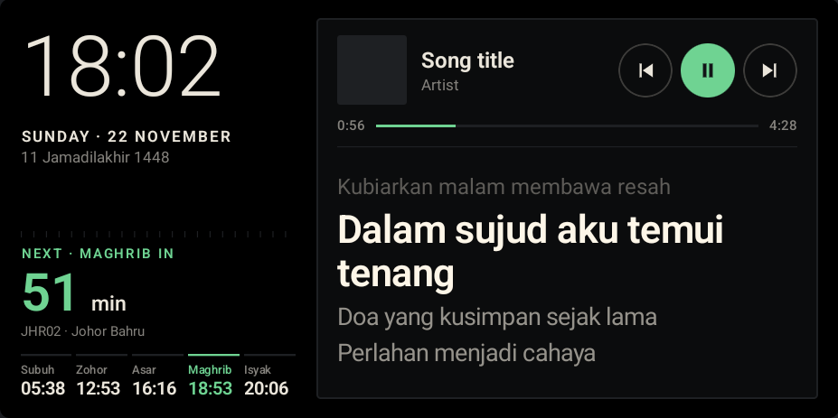
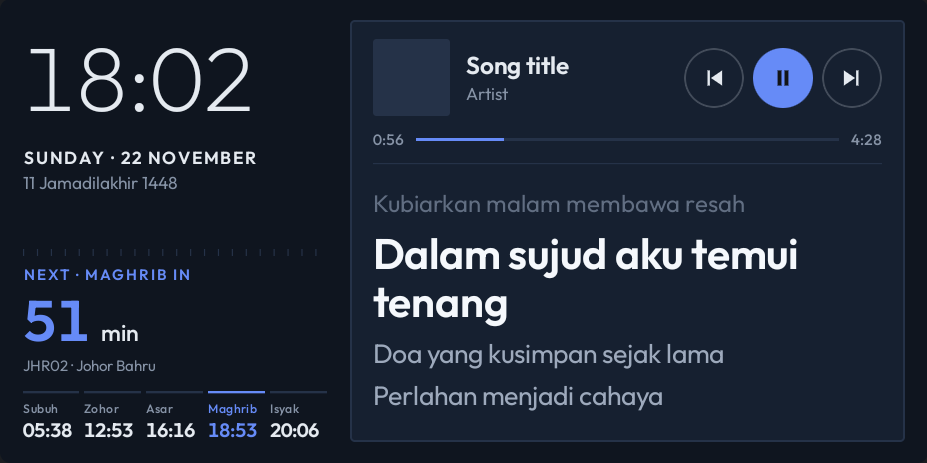
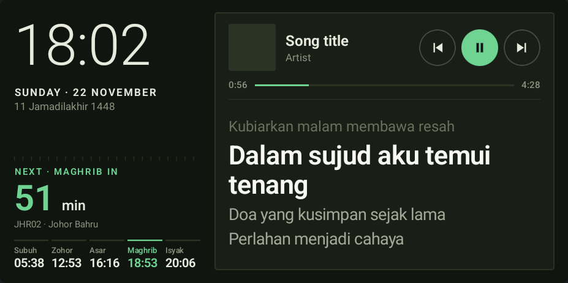
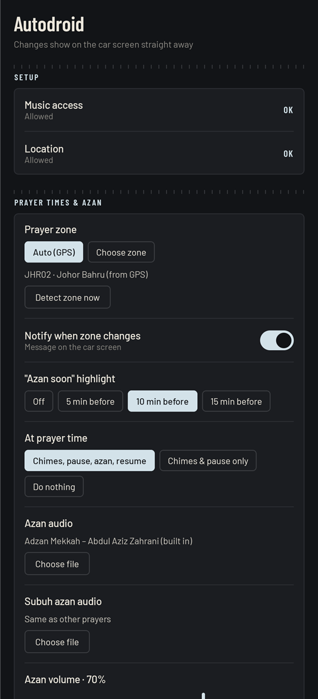
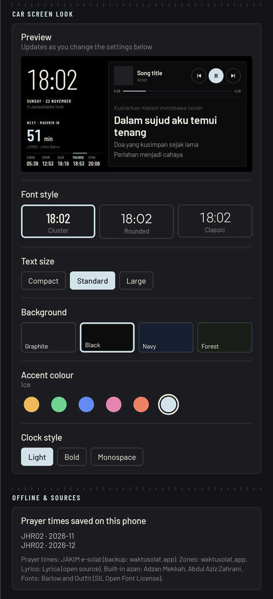

<p align="center"></p>

<h1 align="center">Autodroid</h1>

<p align="center">A minimal home screen for your Android Auto, with prayer times and synced lyrics.</p>

<p align="center"><a href="https://github.com/munshyn/autodroid/raw/main/releases/Autodroid-1.2.0.apk"><b>⬇ Download Autodroid 1.2.0 (APK, 3.3 MB)</b></a></p>

Autodroid fills the car screen with the things you glance at while driving: the time and date (with the
Hijri date), how long until the next prayer, and the song playing in YT Music with its lyrics moving along
line by line. At prayer time it plays the azan and pauses your music, then picks the music up again
afterwards. Everything runs on free services; no accounts or paid APIs.

<p align="center"></p>

<p align="center">
  
  
</p>

## What's on the car screen

- **Clock** with day, date and Hijri date, 12- or 24-hour, optional greeting.
- **Next prayer** with a countdown and all five times for the day, from JAKIM e-solat for your zone. The
  zone is found from GPS (or picked by hand), and times are saved on the phone so they work with no signal.
- **Azan:** three chimes, the music pauses, the azan plays, and the music resumes a second after it ends.
  Tap the prayer box to stop early. "Chimes and pause only" or "do nothing" are also available.
- **Music** from YT Music: album art, title, progress, previous / play-pause / next.
- **Synced lyrics** from [Lyrica](https://github.com/Wilooper/Lyrica): the previous line, the current line
  large, and the next lines coming up.
- **YouTube when parked:** tap **Video** on the car screen, or in the YouTube app on the phone choose
  **Share › Play on car screen**. Video only opens while the car is stopped and closes as soon as it moves
  (speed from the car, or the phone's GPS if the car doesn't share it).

Autodroid registers as a navigation app, which gives it the whole car screen. It has no map: switch to
Google Maps or Waze from the Android Auto taskbar for directions, and Autodroid keeps running (the azan still
plays).

## Settings on the phone

<p align="center">
  
  
</p>

Open Autodroid on the phone to change things; the car screen updates straight away.

- Music access, location and car speed permissions
- Prayer zone (GPS or chosen), "azan soon" warning, what happens at prayer time, azan and Subuh audio,
  azan volume, resume music, test
- 24-hour clock, Hijri date, greeting, English or Bahasa Melayu
- Lyrics on / current line only / off, lyrics size, lyrics timing
- Car screen look: font style (Cluster, Rounded, Classic), text size, background (Black by default, or
  Graphite, Navy, Forest), six accent colours (Ice by default), clock style, with a live preview of the car
  screen

Prayer times and zone names are for Malaysia (JAKIM zones).

## Installing

Android Auto only lists apps like Autodroid when it believes they came from the Play Store, so tapping the
APK to install it isn't enough: the app installs, but Android Auto hides it. It has to be installed through
the phone's own installer with the Play Store recorded as the source, which needs a PC once:

1. On the phone, turn on **Developer options › Wireless debugging** and note the IP address and port.
2. On a Windows PC with [Android platform-tools](https://developer.android.com/tools/releases/platform-tools)
   on the same Wi-Fi, download the APK and [install-to-phone.ps1](install-to-phone.ps1), then run:

   ```powershell
   .\install-to-phone.ps1 -Phone <ip>:<port> -Apk .\Autodroid-1.2.0.apk
   ```

3. Unlock the phone and tap **Install** (or **Update**).
4. In Android Auto settings › **Customise launcher**, tick Autodroid.

Allow **Music access** and **Location** in Autodroid on the phone. More detail and troubleshooting:
[CAR_SETUP.md](CAR_SETUP.md).

## Sources

- Prayer times: [JAKIM e-solat](https://www.e-solat.gov.my), backup [waktusolat.app](https://waktusolat.app)
- Zones from GPS: waktusolat.app
- Lyrics: [Lyrica](https://github.com/Wilooper/Lyrica) (open source; searches LRCLIB, NetEase and others)
- Fonts: [Barlow](https://github.com/jpt/barlow) and [Outfit](https://github.com/Outfitio/Outfit-Fonts), SIL Open Font License
